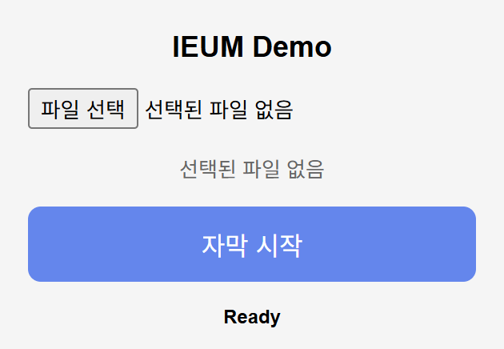
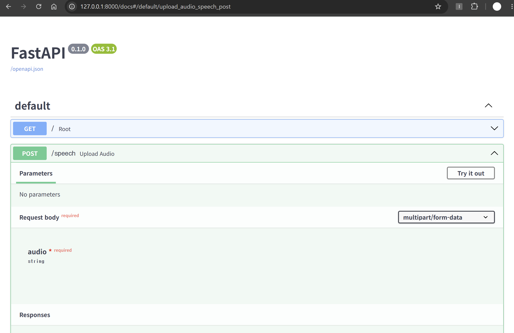
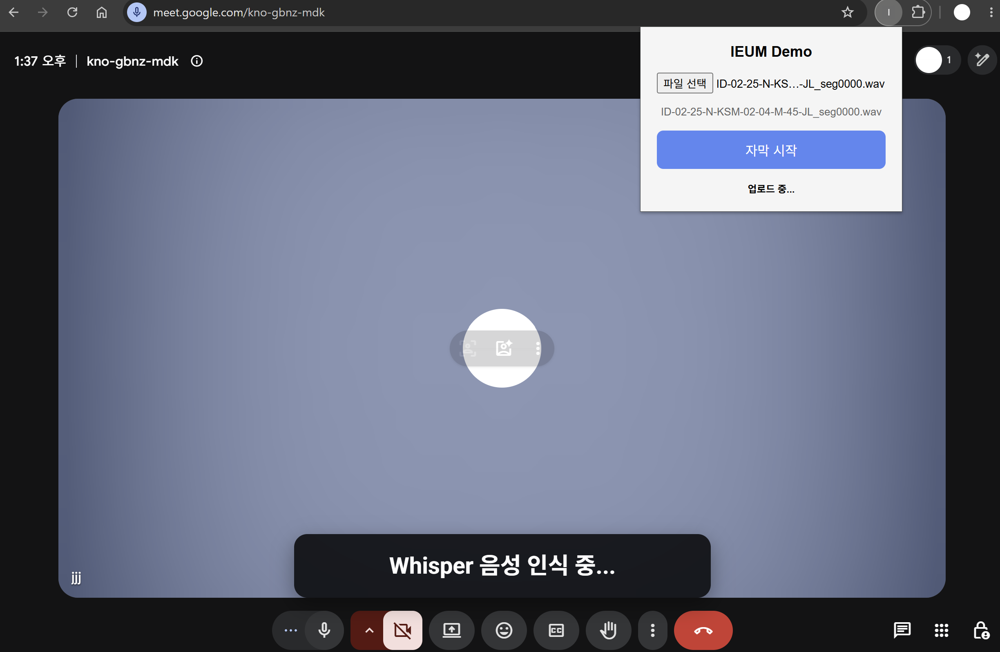
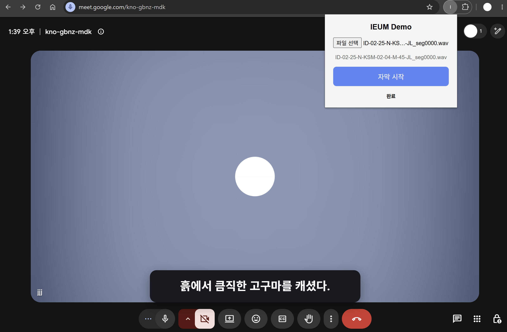
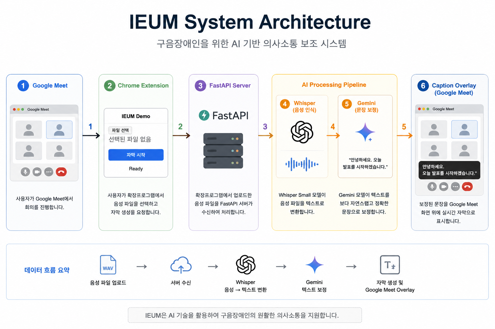
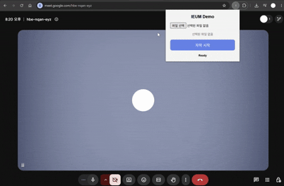

# IEUM (이음)

## 구음장애인을 위한 AI 기반 의사소통 보조 시스템

IEUM은 구음장애인의 의사소통을 지원하기 위한 AI 기반 자막 생성 시스템입니다. 현재는 **WAV 파일 업로드 기반 데모**로 구현되어 있습니다. 업로드한 음성 파일을 전처리한 후, 팀에서 파인튜닝한 **Whisper-small 기반 범용 ASR 모델**로 텍스트를 생성하고, Chrome 확장 프로그램을 통해 Google Meet 화면에 자막을 표시합니다.

## System Pipeline

```text
Google Meet에서 IEUM Chrome Extension 실행
                ↓
          WAV 파일 업로드
                ↓
        FastAPI POST /speech
                ↓
            음성 전처리
      ├─ 스테레오 → 모노 변환
      └─ 샘플레이트 → 16,000Hz (필요 시)
                ↓
    IEUM 범용 ASR (fine-tuned Whisper-small)
                ↓
          인식 텍스트 반환
                ↓
       Google Meet Caption Overlay
```

## Features

- Chrome Extension (Manifest V3) 기반 Google Meet 자막 오버레이
- FastAPI 기반 WAV 파일 업로드 및 음성 인식 API (`POST /speech`)
- 팀에서 파인튜닝한 Whisper-small 기반 한국어 범용 ASR 모델 연동
- 스테레오 음성의 모노 변환
- 입력 샘플레이트가 16kHz가 아닐 때 자동 리샘플링 (`scipy.signal.resample_poly`)
- 음성 인식 결과를 Google Meet 화면에 자막으로 표시

## Project Structure


## Project Structure

```text
ieum_meeting/
├── backend/
│   ├── gemini_model.py
│   ├── main.py
│   ├── test_gemini.py
│   ├── test_whisper.py
│   └── whisper_model.py
│
├── docs/
├── extension/
├── ieum_demo/
├── sample_audio/
├── src/
│
├── test_general_asr.py
├── README.md
└── requirements.txt
```

> 위 구조는 기존 프로젝트 문서를 바탕으로 정리했습니다. 실제 저장소의 파일명과 구성에 맞춰 최종 확인해 주세요.

## Tech Stack

- **Backend:** Python, FastAPI, Uvicorn
- **ASR:** PyTorch, Hugging Face Transformers, fine-tuned Whisper-small
- **Audio processing:** SoundFile, NumPy, SciPy
- **Extension:** Chrome Extension (Manifest V3), HTML, CSS, JavaScript

## Installation

### 1. Clone Repository

```bash
git clone <repository_url>
cd <repository_directory>
```

`<repository_url>`과 `<repository_directory>`를 실제 저장소 정보로 바꿔 주세요.

### 2. Create and Activate Virtual Environment

개발 및 테스트에 사용한 Python 버전은 **3.13**입니다.

**macOS / Linux**

```bash
python3.13 -m venv venv
source venv/bin/activate
```

**Windows (PowerShell)**

```powershell
py -3.13 -m venv venv
.\venv\Scripts\Activate.ps1
```

### 3. Install Dependencies

프로젝트 루트에서 실행합니다.

```bash
python -m pip install -r requirements.txt
```

> `requirements.txt`는 현재 macOS 개발 환경에서 확인한 주요 패키지 버전을 기준으로 작성했습니다. 다른 OS에서는 PyTorch 설치 호환성을 별도로 확인해야 할 수 있습니다.

### 4. Prepare the ASR Model

학습된 모델 및 프로세서 파일은 프로젝트 외부의 다음 경로에 배치합니다.

```text
~/IEUM_models/
└── whisper_small_general_v1/
    ├── model/
    └── processor/
```

`backend/whisper_model.py`는 위 경로에서 모델과 프로세서를 읽도록 설정되어 있습니다. 모델 파일은 별도로 전달받아 배치해야 하며, 저장소에 포함되지 않을 수 있습니다. 모델 배포 권한을 확인한 후 공유해 주세요.

## Run

### 1. Start FastAPI Server

가상환경이 활성화된 상태에서:

```bash
cd backend
python -m uvicorn main:app --reload
```

서버 주소: `http://127.0.0.1:8000`

Swagger UI: `http://127.0.0.1:8000/docs`

### 2. Load Chrome Extension

1. Chrome에서 `chrome://extensions`에 접속합니다.
2. **개발자 모드**를 활성화합니다.
3. **압축해제된 확장 프로그램 로드**를 클릭합니다.
4. 프로젝트의 `extension` 폴더를 선택합니다.

### 3. Run Demo

1. FastAPI 서버를 실행한 상태에서 Google Meet에 접속합니다.
2. IEUM Chrome 확장 프로그램을 엽니다.
3. WAV 파일을 선택합니다.
4. **자막 시작** 버튼을 클릭합니다.
5. Google Meet 화면에 출력되는 자막을 확인합니다.

### 4. Stop Server

서버 터미널에서 `Ctrl + C`를 누릅니다.

## API

### `POST /speech`

WAV 파일을 업로드하면 전처리 및 ASR 추론 후 결과를 반환합니다.

응답 예시:

```json
{
  "success": true,
  "filename": "sample1.wav",
  "asr": "국에서 넓죽한 고구마를 캐셨다",
  "corrected": "국에서 넓죽한 고구마를 캐셨다",
  "processing_time_sec": 4.56
}
```

`corrected` 필드는 기존 Chrome 확장 프로그램과의 호환성을 위해 유지합니다. 현재는 별도 문장 보정 없이 `asr`과 동일한 텍스트를 반환합니다.

## Test Results

- **16,000Hz WAV:** ASR 결과 정상 반환 및 자막 출력 확인
- **44,100Hz WAV:** 16,000Hz 자동 리샘플링 후 ASR 결과 정상 반환
- **Chrome Extension:** Google Meet 자막 오버레이 출력 확인

44,100Hz 파일 처리 시 서버 로그 예시:

```text
[Audio] 원본 샘플레이트: 44100Hz
[Audio] 리샘플링: 44100Hz → 16000Hz
[Audio] 리샘플링 완료
```

이는 기능 연동 테스트 결과이며, 다양한 음성에 대한 정량적 인식 정확도 평가를 의미하지는 않습니다.

## Demo

기존 README에 사용하던 자료가 실제 저장소에 존재하는 경우 다음 경로를 그대로 사용할 수 있습니다.

### Chrome Extension



### FastAPI Backend



### Caption Generation



### Final Result



### System Architecture



## Presentation & Demo

- [IEUM Presentation (PDF)](docs/ieum_presentation.pdf)
- 

> 이미지, PDF, GIF 파일이 실제 `docs/` 경로에 없다면 해당 파일을 추가하거나 링크를 제거해 주세요.

## Future Work

- 다양한 샘플레이트 및 WAV 파일에 대한 추가 테스트
- 긴 음성 파일의 구간 분할 처리 검토
- WER/CER 기반 인식 정확도 평가
- 실행 환경 및 모델 배포 절차 정리
- Chrome Extension 사용성 개선
